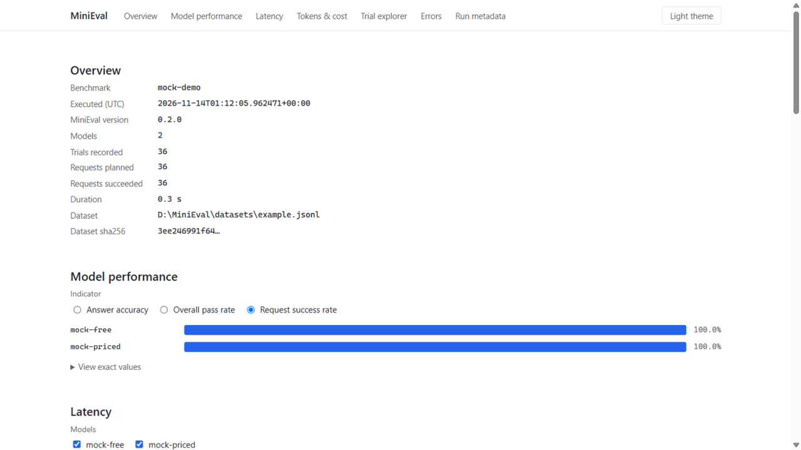

# MiniEval

MiniEval is a lightweight Python framework for benchmarking and comparing language models. It runs the same dataset against several models through LiteLLM, scores responses with deterministic metrics, and produces reproducible JSON, Markdown and interactive HTML reports, including side-by-side comparison of several runs. A deterministic mock provider is included, so a full benchmark can run without any API key.

## Features

- Multi-model benchmarks configured from a single YAML file
- LiteLLM providers: OpenAI, Anthropic, Ollama and other supported backends
- Deterministic mock provider for offline runs and testing
- JSONL datasets with per-entry metrics: `exact_match`, `contains`, `regex`
- Repeated trials with per-repeat derived seeds, deterministic planning and optional shuffling
- Capped concurrency with request latency, queue delay and total duration reported separately
- Distinct indicators: request success rate, answer accuracy, evaluation coverage, overall pass rate
- Token and cost totals with explicit coverage; partial sums are never presented as complete
- Bounded retries for transient provider errors only, honoring `Retry-After`
- Error messages sanitized before export; no API keys, tokens or credentials in reports
- JSON and Markdown reports with a run manifest (version, UTC date, seed, per-repeat seeds, dataset fingerprint)
- Self-contained interactive HTML report: charts, trial explorer, light and dark themes, no server, no network
- Side-by-side comparison of several runs with methodological warnings
- CSV export of individual trials and a local history of past runs
- CLI with Rich table output: `validate`, `run`, `report`, `compare`, `export`, `history`

## Requirements

- Python 3.12 or newer
- Windows, Linux or macOS
- An API key in the environment only when calling real providers (for example `OPENAI_API_KEY`); the mock provider needs nothing

## Installation

From source with uv:

```bash
git clone https://github.com/OmegaMc1331/minieval-bench.git
cd minieval-bench
uv sync
uv run minieval-bench --help
```

As a standalone tool installed from GitHub:

```bash
uv tool install git+https://github.com/OmegaMc1331/minieval-bench
```

With pip:

```bash
pip install git+https://github.com/OmegaMc1331/minieval-bench
```

## Quick start without an API key

The repository ships a benchmark that uses only the mock provider:

```bash
uv run minieval-bench validate --config benchmarks/example.yaml
uv run minieval-bench run --config benchmarks/example.yaml --output results/
uv run minieval-bench report --input results/
```

Example output of `run` on the bundled benchmark (seed 42, 6 entries, 3 repeats, 2 models):

```text
                                                    Benchmark results
┌─────────────┬──────────┬────┬────────┬─────────┬──────────┬──────────┬─────────┬─────────────┬──────────┬────────────┬───────────┬────────────┬────────────┐
│ Model       │ Requests │ OK │ Failed │ Success │ Accuracy │ Coverage │ Overall │ Median (ms) │ P95 (ms) │ Queue (ms) │ In tokens │ Out tokens │ Cost (USD) │
├─────────────┼──────────┼────┼────────┼─────────┼──────────┼──────────┼─────────┼─────────────┼──────────┼────────────┼───────────┼────────────┼────────────┤
│ mock-free   │       18 │ 18 │      0 │  100.0% │    50.0% │   100.0% │   50.0% │        25.8 │     40.5 │       39.6 │        96 │         72 │        n/a │
│ mock-priced │       18 │ 18 │      0 │  100.0% │    50.0% │   100.0% │   50.0% │        32.0 │     42.5 │      153.1 │        96 │         72 │   0.000156 │
└─────────────┴──────────┴────┴────────┴─────────┴──────────┴──────────┴─────────┴─────────────┴──────────┴────────────┴───────────┴────────────┴────────────┘
```

The accuracy of 50% comes from the dataset itself: three entries match the mock response format (`mock-` plus eight hex characters) and three deliberately do not.

## Configuration

A benchmark is described in one YAML file:

```yaml
benchmark: my-benchmark
dataset: datasets/my-dataset.jsonl

defaults:
  repeats: 3
  concurrency: 4
  seed: 42
  timeout: 60
  max_tokens: 512
  temperature: 0.2
  shuffle: false

models:
  - name: gpt-4o-mini
    model: openai/gpt-4o-mini
  - name: claude-haiku
    model: anthropic/claude-3-5-haiku-latest
    temperature: 0.0
  - name: local-llama
    model: ollama/llama3.1
    timeout: 120
  - name: mock-free
    provider: mock
```

Dataset paths are resolved relative to the config file. Every field under `defaults` applies to all models and can be overridden per model.

### Model fields

| Field | Description |
| --- | --- |
| `name` | Display name used in reports; must be unique |
| `provider` | `litellm` (default) or `mock` |
| `model` | LiteLLM model string, for example `openai/gpt-4o-mini`; defaults to `name` for mock models |
| `temperature` | Sampling temperature, forwarded when set |
| `max_tokens` | Maximum completion tokens |
| `timeout` | Request timeout in seconds |
| `drop_params` | Have LiteLLM drop parameters the provider rejects instead of failing the request |
| `input_cost_per_1m`, `output_cost_per_1m` | Optional USD prices per one million tokens, used for cost estimation |

API keys are never stored in the configuration or written to reports. LiteLLM reads them from the environment (`OPENAI_API_KEY`, `ANTHROPIC_API_KEY`, ...).

A parameter a provider rejects (for example `temperature` on some reasoning models) fails the affected requests and shows up in the error breakdown; it is never silently ignored. Set `drop_params: true` on the model to have LiteLLM drop unsupported parameters instead.

### Defaults fields

| Field | Default | Description |
| --- | --- | --- |
| `repeats` | 1 | Number of times each entry is sent to each model |
| `concurrency` | 4 | Maximum simultaneous requests across the whole run |
| `seed` | 0 | Global seed; per-repeat seeds are derived from it (see Reproducibility) |
| `timeout` | 60 | Request timeout in seconds |
| `max_tokens` | none | Default maximum completion tokens |
| `temperature` | none | Default sampling temperature |
| `shuffle` | false | Deterministically shuffle the execution plan so no model is systematically served first |

## Dataset format

Datasets are JSONL files, one JSON object per line:

```jsonl
{"id": "capital-fr", "prompt": "What is the capital of France? Answer with the city name only.", "metric": "exact_match", "reference": "Paris"}
{"id": "vowel-word", "prompt": "Name a word containing all five vowels.", "metric": "contains", "reference": "europe"}
{"id": "hex-id", "prompt": "Give an identifier in hex format.", "metric": "regex", "reference": "^[0-9a-f]{8}$", "system": "Answer as briefly as possible."}
```

| Field | Required | Description |
| --- | --- | --- |
| `id` | yes | Unique entry identifier |
| `prompt` | yes | User prompt |
| `metric` | yes | One of `exact_match`, `contains`, `regex` |
| `reference` | yes | Expected answer, contained text, or regular expression |
| `system` | no | System prompt for this entry |

Validation rules: ids must be unique, regex references must compile, unknown fields are rejected. Errors are reported with the file name and line number.

## Metrics

- `exact_match`: the response equals the reference after normalization.
- `contains`: the reference appears in the response after normalization.
- `regex`: the reference is a regular expression matched with `re.search` against the raw response.

Normalization lowercases the text, strips surrounding whitespace, removes characters that are neither word characters nor whitespace, and collapses internal whitespace. `regex` is matched against the unmodified response.

Limits: these metrics are objective but narrow. They suit prompts with a single verifiable answer or a required output format. Open-ended generation has no reference to compare against, and MiniEval deliberately does not invent a correctness score for it; leave such prompts out of scored datasets or express the expected format as a `regex`.

## Statistics

MiniEval reports four rates with explicit denominators, because they answer different questions:

| Indicator | Formula | Question answered |
| --- | --- | --- |
| Request success rate | requests without provider error / planned requests | Is the provider reliable? |
| Answer accuracy | correct answers / evaluable answers (successful requests) | When it answers, is it right? |
| Evaluation coverage | evaluated trials / planned requests | How much of the plan produced a scored answer? |
| Overall pass rate | correct answers / planned requests | Combining both, how often does it succeed? |

A model with frequent provider errors can keep a high accuracy on the answers it does produce; the success rate and the overall pass rate expose that. Failed requests count as not passed for the overall pass rate but never count as incorrect answers in the accuracy. `score` in the JSON output is kept as an alias of `answer_accuracy` for compatibility with v0.1.0.

### Partial consumption data

Token and cost totals are sums over the requests that reported them. When only some successful requests report usage, the total is shown as partial: `45 (7/10)` means 45 tokens summed over 7 of 10 successful requests. A value of `n/a` means no request reported the data — it is never used for a real zero. Cost is computed from `input_cost_per_1m` and `output_cost_per_1m` when both are set; otherwise LiteLLM's bundled price map is consulted; when neither source knows the price, the cost is `n/a`. Tokens may be reported while cost is `n/a` and vice versa.

### Latency, queue and duration

Each trial records `latency_ms`, the duration of the provider call itself, and `queue_ms`, the time the task waited in the execution pool before starting. Waiting in the queue is never counted as model response time. The manifest records `duration_seconds`, the wall-clock time of the whole run. Latency percentiles are computed over successful requests only.

## Reproducibility

- The global `seed` is configurable. Each repeat derives its own trial seed deterministically from it (`sha256("<seed>:<repeat>")`), so repeats sample differently while remaining reproducible; the derived seeds are recorded in the manifest. All models answering the same entry in the same repeat receive the same seed when the provider supports it.
- The execution plan (model, entry, repeat) is rebuilt identically from the configuration and the seed, with or without `shuffle`. Trial order in `results.json` follows the plan via `plan_index`; completion order depends on runtime scheduling and is not part of the export.
- Seeds are best effort: they are forwarded to providers that support them, and the mock provider uses them directly. A seed does not guarantee identical answers across providers, runs or API versions.

## Error handling and retries

Each request is attempted up to 3 times (1 initial attempt + 2 retries) and only for transient failures: HTTP 408, 409, 429, 500, 502, 503, 504, timeouts and connection errors. A `Retry-After` hint is honored when present and at most 30 seconds; otherwise the backoff is 0.5s then 1s. Authentication errors (401, 403), invalid requests (400, 404) and other configuration problems are never retried. Network attempts are distinct from benchmark repeats: a retried request still counts as one trial. Requests that support paid APIs stay bounded by this fixed limit.

Provider errors are recorded per trial with their exception type and a sanitized message: API keys, bearer tokens, passwords, URL credentials and query strings are masked, and the message is truncated to 400 characters. The same policy applies to JSON exports, Markdown reports and terminal output.

## Commands

```bash
minieval-bench validate --config benchmarks/example.yaml
minieval-bench run --config benchmarks/example.yaml --output results/
minieval-bench report --input results/
minieval-bench report --input results/ --format html --output results/report.html
minieval-bench compare --run results/run-a --run results/run-b --output comparison.html
minieval-bench export --input results/ --format csv --output results/trials.csv
minieval-bench history --root results/
minieval-bench --version
```

`run` exits with code 1 when every request failed, so it can gate CI jobs, and with code 130 when interrupted (Ctrl+C); pending requests are cancelled and no reports are written.

`run` writes `report.html` next to the other reports; pass `--no-html` to skip it. Pass `--snapshot` to embed the dataset (prompts and references) in `results.json` and the HTML report, so the trial explorer can display them.

## Reports

`run` writes four files:

- `manifest.json`: effective parameters, models, MiniEval version, UTC date, global and per-repeat seeds, shuffle flag, duration, dataset path and SHA-256 fingerprint
- `results.json`: manifest, per-model statistics and every individual trial (response, latency, queue delay, tokens, cost, sanitized errors, plan index), plus the dataset snapshot when `--snapshot` was used
- `report.md`: the same statistics as Markdown
- `report.html`: the interactive report described below

Example `report.md`:

```markdown
# MiniEval report: mock-demo

- MiniEval version: 0.1.1
- Created (UTC): 2026-11-14T00:37:16.442457+00:00
- Seed: 42
- Repeats: 3
- Concurrency: 4
- Shuffle: False
- Duration (s): 0.3
- Dataset: `datasets/example.jsonl` (6 entries, sha256 `3ee24699...`)

## Results

| Model | Requests | OK | Failed | Success | Accuracy | Coverage | Overall | Median (ms) | P95 (ms) | Queue (ms) | In tokens | Out tokens | Cost (USD) |
| --- | --- | --- | --- | --- | --- | --- | --- | --- | --- | --- | --- | --- | --- |
| mock-free | 18 | 18 | 0 | 100.0% | 50.0% | 100.0% | 50.0% | 25.8 | 40.5 | 39.6 | 96 | 72 | n/a |
| mock-priced | 18 | 18 | 0 | 100.0% | 50.0% | 100.0% | 50.0% | 32.0 | 42.5 | 153.1 | 96 | 72 | 0.000156 |

Indicators, with their explicit denominators:

- **Success** = requests completed without provider error / planned requests.
- **Accuracy** = correct answers / evaluable answers (successful requests).
- **Coverage** = evaluated trials / planned requests.
- **Overall** = correct answers / planned requests; failed requests count as not passed.
```

Reports produced by v0.1.0 remain readable: indicators that can be derived from the old fields (accuracy, coverage, overall pass rate, incorrect count) are computed on load; data that the old format does not contain (per-repeat seeds, duration, consumption coverage) is shown as `n/a`.

### Confidentiality

Error messages are sanitized, but model responses and prompts are exported verbatim because scoring requires them. A results directory can therefore contain private data from your datasets and conversations, and the same applies to the HTML and CSV exports. Review every file before sharing or publishing it; results directories are excluded from the repository by `.gitignore`.

## Interactive HTML report

`run` produces `report.html` alongside the other reports, and `report --format html` regenerates it from any results directory. The file is fully self-contained: styles, scripts and data are embedded in a single HTML file that opens directly in a browser, with no server, no network access and no CDN dependency. All rendering happens locally, and untrusted content (prompts, responses, error messages, model names) is inserted as text only, never as HTML.

Sections:

1. **Overview** — benchmark, date, models, planned and succeeded requests, duration, dataset fingerprint, version.
2. **Model performance** — selectable indicator (accuracy, overall pass rate, success rate), exact values table.
3. **Latency** — per-model histograms of individual request latencies with bin counts, model filter, queue delay reported separately.
4. **Tokens & cost** — stacked input/output bars with coverage, cost comparison distinguishing known, partially known, zero and unavailable costs.
5. **Trial explorer** — every trial in a searchable, filterable, sortable, paginated table; selecting a row shows the full response, error, and the prompt and reference when the run used `--snapshot`.
6. **Errors** — breakdown by type and model, list of failed requests.
7. **Run metadata** — manifest values and model configurations.

The report follows the system light or dark theme, switches manually without reloading, and works on narrow screens: tables scroll horizontally and the layout collapses to a single column. Charts carry text equivalents (exact-value tables) and the explorer is operable from the keyboard.




## Comparing runs

```bash
minieval-bench compare --run results/run-a --run results/run-b --output comparison.html
```

The command accepts two or more run directories and writes a self-contained HTML report. It first shows the experimental conditions of every run with differing cells highlighted (seed, repeats, concurrency, dataset fingerprint, version), then a comparability box listing every detected difference: changed datasets, changed model configuration behind a same display name, differing seeds or parameters. Per common model, each indicator is shown per run with an absolute delta (first → last) and a relative delta. Relative deltas are computed only when both values exist and the reference value is not zero; everything else reads `n/a`. No statement of statistical superiority is generated.

Because equal display names do not prove equal models, configuration fields (provider, model string, temperature, max tokens, timeout) are compared and any drift is reported. When datasets differ, score differences are explicitly flagged as potentially caused by the dataset change.


## CSV export

```bash
minieval-bench export --input results/ --format csv --output results/trials.csv
```

Exports one row per trial with the columns: `model, entry_id, repeat, ok, passed, latency_ms, queue_ms, input_tokens, output_tokens, cost_usd, error_type, error_message`. Conventions: UTF-8; missing values are empty fields and are never converted to zero; booleans are `true`/`false`; cells that could be interpreted as spreadsheet formulas (starting with `=`, `+`, `-`, `@` or a tab) are prefixed with a single quote. Responses are intentionally not included; use the JSON export or the HTML trial explorer for them.

## Local history

```bash
minieval-bench history --root results/
```

Scans a directory and its subdirectories for runs (a `manifest.json`, or a `results.json` containing one) and lists them by execution date: benchmark name, date, model count, planned requests, MiniEval version and location. Incomplete or unreadable directories are skipped silently. There is no database and no indexing outside the given root.

## Limitations

- Correction metrics require an objective reference; there is no LLM-as-judge or subjective scoring.
- The mock provider simulates latency, tokens and deterministic answers, not realistic model behavior.
- Latency numbers depend on concurrency and network conditions; compare medians across runs with the same `concurrency`.
- There is no checkpointing: an interrupted run cannot resume; rerun it instead.
- `results.json` and `report.html` contain full responses; on very large benchmarks the HTML file grows accordingly (roughly 70 KB per 10,000 short trials plus the responses themselves).
- The trial explorer paginates to keep the DOM small, but the whole dataset is embedded in the HTML file; there is no lazy loading from disk.
- Comparison reports show deltas between the first and the last run; intermediate trends are visible in the per-run columns.

## Development

```bash
uv sync
uv run ruff check .
uv run pytest
```

The test suite runs fully offline using the mock provider.

## Contributing

See [CONTRIBUTING.md](CONTRIBUTING.md).

## License

MIT, see [LICENSE](LICENSE).
