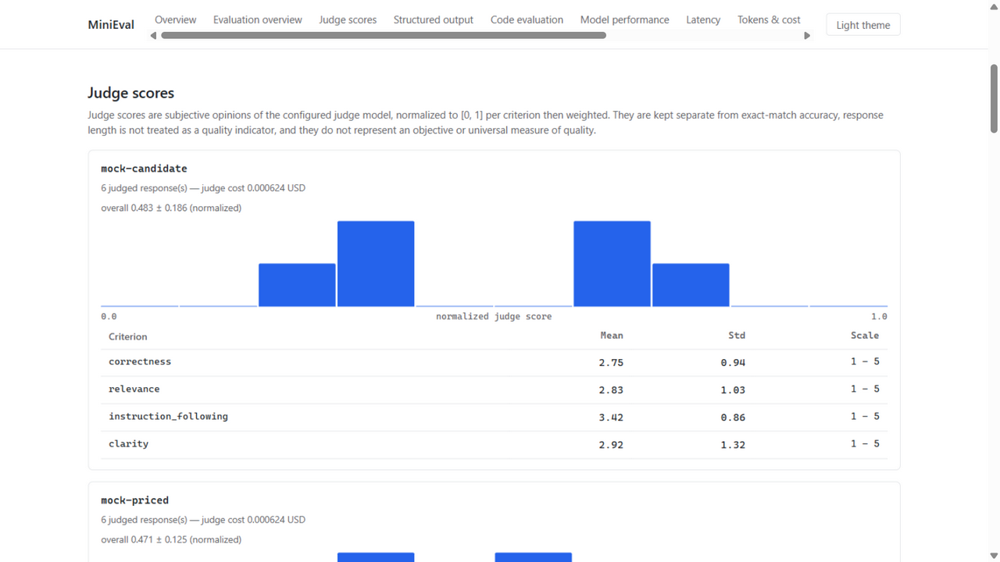
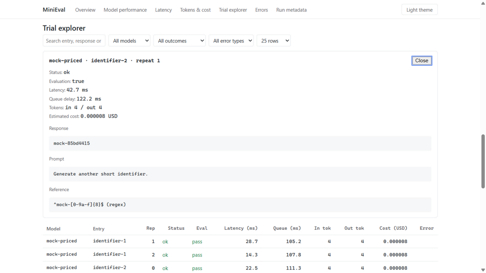
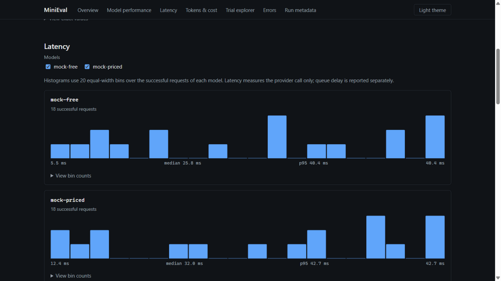
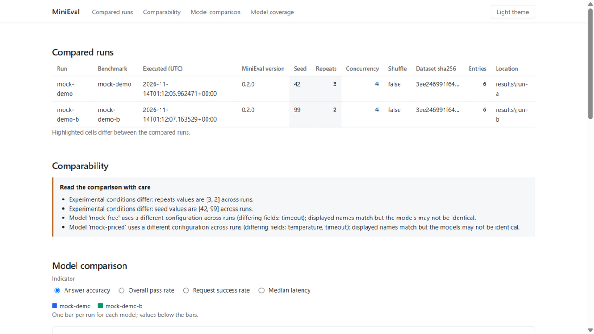
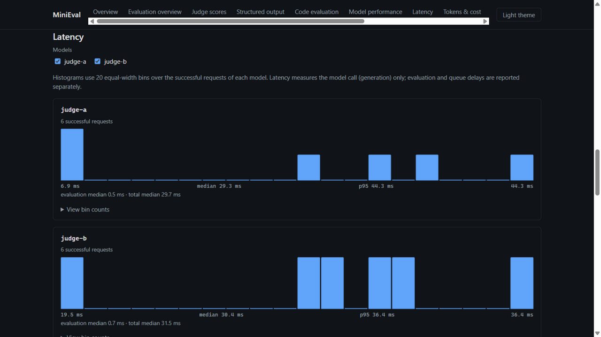
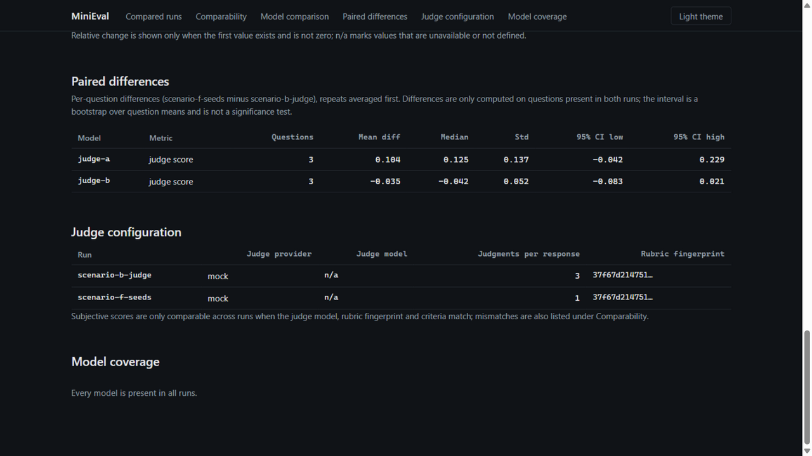

# MiniEval

MiniEval is a lightweight Python framework for benchmarking and comparing language models. It runs the same dataset against several models through LiteLLM, scores responses with deterministic metrics, LLM judges, JSON Schema validation and containerized code tests, and produces reproducible JSON, Markdown and interactive HTML reports with statistical analysis and side-by-side comparison of several runs. A deterministic mock provider and mock judge are included, so a full benchmark can run without any API key.

## Features

- Multi-model benchmarks configured from a single YAML file
- LiteLLM providers: OpenAI, Anthropic, Ollama and other supported backends
- Deterministic mock provider and mock judge for offline runs and testing
- Deterministic metrics: `exact_match`, `contains`, `regex`
- LLM-as-a-judge evaluation with custom rubrics, repeated judgments, budgets and calibration
- Blind pairwise comparison with position swapping
- Structured output validation against JSON Schema (Draft 2020-12)
- Code evaluation: generated Python tested inside a restricted Docker container, with a process-separated harness whose verdicts cannot be forged by evaluated programs, bounded output capture and an image pinned by digest
- Statistical analysis: dispersion, percentile bootstrap intervals over question-level units, paired differences between runs
- Repeated trials with per-repeat derived seeds, deterministic planning and optional shuffling
- Capped concurrency with generation latency, evaluation latency, total time and queue delay reported separately
- Distinct indicators: request success rate, answer accuracy (deterministic metrics), JSON conformance, code pass rate, judge score, evaluation coverage, overall pass rate
- Token and cost totals with explicit coverage; generation and evaluation costs reported separately
- Bounded retries for transient provider errors only, honoring `Retry-After`
- Error messages sanitized before export; no API keys, tokens or credentials in reports
- JSON and Markdown reports with a run manifest (version, UTC date, seed, per-repeat seeds, dataset fingerprint)
- Self-contained interactive HTML report: charts, trial explorer, light and dark themes, no server, no network
- Side-by-side comparison of several runs with methodological warnings
- Re-evaluation of stored responses without new generation calls
- CSV export of individual trials and a local history of past runs
- CLI with Rich table output: `validate`, `run`, `report`, `compare`, `export`, `history`, `evaluate`, `pairwise`, `calibrate`

## Requirements

- Python 3.12 or newer
- Windows, Linux or macOS
- An API key in the environment only when calling real providers (for example `OPENAI_API_KEY`); the mock provider needs nothing

## Installation

From source with uv:

```bash
git clone https://github.com/OmegaMc1331/minieval-bench.git
cd minieval-bench
uv sync
uv run minieval-bench --help
```

As a standalone tool installed from GitHub:

```bash
uv tool install git+https://github.com/OmegaMc1331/minieval-bench
```

With pip:

```bash
pip install git+https://github.com/OmegaMc1331/minieval-bench
```

## Quick start without an API key

The repository ships offline examples for every evaluation type, all runnable without an API key:

```bash
uv run minieval-bench validate --config benchmarks/example.yaml
uv run minieval-bench run --config benchmarks/example.yaml --output results/
uv run minieval-bench run --config benchmarks/judge-mock.yaml --output results/judge
uv run minieval-bench run --config benchmarks/json-schema.yaml --output results/schema
uv run minieval-bench run --config benchmarks/code-python.yaml --output results/code
uv run minieval-bench report --input results/
```

`judge-mock` uses the deterministic mock judge with the rubric in `rubrics/general.yaml`; `json-schema` validates mock responses against three schemas (the mock never returns JSON, so it demonstrates the error reporting); `code-python` runs the generated code in the restricted Docker container when the daemon is reachable, and reports `unavailable` otherwise.

Example output of `run` on the bundled benchmark (seed 42, 6 entries, 3 repeats, 2 models):

```text
                                                    Benchmark results
┌─────────────┬──────────┬────┬────────┬─────────┬──────────┬──────────┬─────────┬─────────────┬──────────┬────────────┬───────────┬────────────┬────────────┐
│ Model       │ Requests │ OK │ Failed │ Success │ Accuracy │ Coverage │ Overall │ Median (ms) │ P95 (ms) │ Queue (ms) │ In tokens │ Out tokens │ Cost (USD) │
├─────────────┼──────────┼────┼────────┼─────────┼──────────┼──────────┼─────────┼─────────────┼──────────┼────────────┼───────────┼────────────┼────────────┤
│ mock-free   │       18 │ 18 │      0 │  100.0% │    50.0% │   100.0% │   50.0% │        25.8 │     40.5 │       39.6 │        96 │         72 │        n/a │
│ mock-priced │       18 │ 18 │      0 │  100.0% │    50.0% │   100.0% │   50.0% │        32.0 │     42.5 │      153.1 │        96 │         72 │   0.000156 │
└─────────────┴──────────┴────┴────────┴─────────┴──────────┴──────────┴─────────┴─────────────┴──────────┴────────────┴───────────┴────────────┴────────────┘
```

The accuracy of 50% comes from the dataset itself: three entries match the mock response format (`mock-` plus eight hex characters) and three deliberately do not.

## Configuration

A benchmark is described in one YAML file:

```yaml
benchmark: my-benchmark
dataset: datasets/my-dataset.jsonl

defaults:
  repeats: 3
  concurrency: 4
  seed: 42
  timeout: 60
  max_tokens: 512
  temperature: 0.2
  shuffle: false

models:
  - name: gpt-4o-mini
    model: openai/gpt-4o-mini
  - name: claude-haiku
    model: anthropic/claude-3-5-haiku-latest
    temperature: 0.0
  - name: local-llama
    model: ollama/llama3.1
    timeout: 120
  - name: mock-free
    provider: mock
```

Dataset paths are resolved relative to the config file. Every field under `defaults` applies to all models and can be overridden per model.

### Model fields

| Field | Description |
| --- | --- |
| `name` | Display name used in reports; must be unique |
| `provider` | `litellm` (default) or `mock` |
| `model` | LiteLLM model string, for example `openai/gpt-4o-mini`; defaults to `name` for mock models |
| `temperature` | Sampling temperature, forwarded when set |
| `max_tokens` | Maximum completion tokens |
| `timeout` | Request timeout in seconds |
| `drop_params` | Have LiteLLM drop parameters the provider rejects instead of failing the request |
| `input_cost_per_1m`, `output_cost_per_1m` | Optional USD prices per one million tokens, used for cost estimation |

API keys are never stored in the configuration or written to reports. LiteLLM reads them from the environment (`OPENAI_API_KEY`, `ANTHROPIC_API_KEY`, ...).

A parameter a provider rejects (for example `temperature` on some reasoning models) fails the affected requests and shows up in the error breakdown; it is never silently ignored. Set `drop_params: true` on the model to have LiteLLM drop unsupported parameters instead.

### Defaults fields

| Field | Default | Description |
| --- | --- | --- |
| `repeats` | 1 | Number of times each entry is sent to each model |
| `concurrency` | 4 | Maximum simultaneous requests across the whole run |
| `seed` | 0 | Global seed; per-repeat seeds are derived from it (see Reproducibility) |
| `timeout` | 60 | Request timeout in seconds |
| `max_tokens` | none | Default maximum completion tokens |
| `temperature` | none | Default sampling temperature |
| `shuffle` | false | Deterministically shuffle the execution plan so no model is systematically served first |

## Dataset format

Datasets are JSONL files, one JSON object per line:

```jsonl
{"id": "capital-fr", "prompt": "What is the capital of France? Answer with the city name only.", "metric": "exact_match", "reference": "Paris"}
{"id": "vowel-word", "prompt": "Name a word containing all five vowels.", "metric": "contains", "reference": "europe"}
{"id": "hex-id", "prompt": "Give an identifier in hex format.", "metric": "regex", "reference": "^[0-9a-f]{8}$", "system": "Answer as briefly as possible."}
{"id": "judge-1", "prompt": "Explain in two sentences why the sky is blue.", "metric": "judge", "reference": "Optional reference shown to the judge"}
{"id": "user-1", "prompt": "Describe a user as JSON with name and age.", "metric": "json_schema", "json_schema": {"type": "object", "properties": {"name": {"type": "string"}, "age": {"type": "integer"}}, "required": ["name", "age"]}}
{"id": "add-function", "prompt": "Write a Python function named add(a, b) returning the sum.", "metric": "code_tests", "tests": "def test_add():\n    assert add(2, 3) == 5\n"}
```

| Field | Required | Description |
| --- | --- | --- |
| `id` | yes | Unique entry identifier |
| `prompt` | yes | User prompt |
| `metric` | yes | One of `exact_match`, `contains`, `regex`, `judge`, `json_schema`, `code_tests` |
| `reference` | for `exact_match`, `contains`, `regex` | Expected answer, contained text, or regular expression; optional extra context for `judge` |
| `system` | no | System prompt for this entry |
| `json_schema` | for `json_schema` | Inline JSON Schema (Draft 2020-12); remote `$ref` URLs are rejected |
| `tests` | for `code_tests` | Python source defining `test_*` functions that call the generated code |

Validation rules: ids must be unique, regex references must compile, unknown fields are rejected. Errors are reported with the file name and line number.

## Metrics

- `exact_match`: the response equals the reference after normalization.
- `contains`: the reference appears in the response after normalization.
- `regex`: the reference is a regular expression matched with `re.search` against the raw response.

Normalization lowercases the text, strips surrounding whitespace, removes characters that are neither word characters nor whitespace, and collapses internal whitespace. `regex` is matched against the unmodified response.

Limits: these metrics are objective but narrow. They suit prompts with a single verifiable answer or a required output format. Open-ended generation has no reference to compare against, and MiniEval deliberately does not invent a correctness score for it; use the `judge` metric for subjective scoring, with the caveats below.

## Advanced evaluation

Generation and evaluation are separate phases. Each trial carries an evaluation record with an evaluator type (`deterministic`, `judge`, `json_schema`, `code_tests`), a status (`completed`, `failed`, `unavailable`), an optional binary verdict and an optional normalized score. Evaluator failures and unavailable evaluators are never counted as incorrect answers: a failed judge call is not a wrong model answer. Subjective judge scores, JSON conformance, code test rates and exact-match accuracy are different measures on different scales and are never merged into one ranking.

### LLM-as-a-judge

```yaml
evaluators:
  judge:
    provider: mock                  # or litellm with a model string
    model: openai/gpt-4o-mini
    temperature: 0
    repeats: 2                      # judgments per response
    rubric: rubrics/general.yaml
    max_calls: 200                  # hard cap on judge calls
    budget_usd: 1.0                 # requires judge pricing to be set
    input_cost_per_1m: 0.15
    output_cost_per_1m: 0.60
```

- The judge reuses the LiteLLM provider stack; `provider: mock` selects a deterministic mock judge for offline runs.
- Rubrics are YAML files (`rubrics/general.yaml` is a working example): criteria with an id, a description, numeric scale bounds and an optional weight. The rubric fingerprint is recorded in every verdict and in the manifest.
- The judge must answer with JSON `{"scores": {...}, "reason": "..."}`. The verdict is validated: all configured criteria present, no unknown criteria, numeric scores within scale bounds. A judge-supplied overall score is ignored; MiniEval computes the overall by normalizing each criterion to `[0, 1]` and applying the configured weights. Malformed verdicts become evaluation failures, never zero scores.
- The evaluated response is wrapped in explicit markers and framed as data to analyze, not instructions; it cannot change the criteria or the output format. This reduces prompt-injection risk but does not guarantee perfect isolation.
- With `repeats > 1`, each judgment is independent; per-criterion means, standard deviations and the count of failed judgments are recorded, separating judge variability from generation variability.
- Budgets: the planned number of judge calls is computed and printed before the run; `max_calls` is an atomically enforced cap shared by all concurrent workers — it refuses to start if the plan exceeds the cap and stops judging when reached. `budget_usd` requires judge pricing to be configured — with unknown pricing MiniEval refuses rather than guessing — and is a documented stop-on-observed guard: judging stops once the recorded spend reaches it, but input-token cost cannot be pre-bounded, so a call already in flight may overshoot it. When `max_tokens` and pricing are known, runs whose output-token cost alone (a lower bound) exceeds `budget_usd` are refused at planning time.
- Judge accounting is independent of verdict validity: every evaluation records the number of calls, responses received, valid verdicts, invalid verdicts, network errors and provider retries, and calls that were billed but produced an unusable verdict still contribute their tokens and cost, with a known-cost count so partial totals are visible.
- Judge tokens and costs are recorded separately from generation costs in every report.

Interpretation: a judge score is the opinion of the configured judge model under the configured rubric — a subjective measure, not a universal quality truth. Judges can be biased by response length, style or phrasing; the prompt explicitly states that length is not a quality indicator, and repeated judgments expose instability instead of hiding it.

### Judge calibration

```yaml
evaluators:
  judge:
    provider: mock
    rubric: rubrics/general.yaml
    calibration: datasets/judge-calibration.jsonl
```

`minieval-bench calibrate --config benchmarks/judge-mock.yaml --output calibration.json` scores a calibration dataset — JSONL items with a prompt, a response and expected per-criterion scores — and reports, per criterion, the mean error against your references and the items that differ by one scale point or more. Agreement does not prove judge validity beyond these examples; without a calibration dataset, judge validity is unverified.

### Blind pairwise comparison

```bash
minieval-bench pairwise --input results/ --config benchmarks/judge-mock.yaml
minieval-bench pairwise --input results/ --config bench.yaml --models model-a model-b
```

For every entry and repeat answered by both models, the judge sees the question and two anonymized responses and must answer `A`, `B` or `tie`. Each pair is judged twice with the positions swapped; verdicts are mapped back to the real models and both verdicts are always kept. Outcomes are explicit: only concordant verdicts count as wins or ties; a win combined with a tie is a mixed verdict, opposite verdicts are disagreements, and fewer than two judgments, judge errors and missing prompts are reported as such — never force-resolved into a winner. Judge errors are masked like provider errors, judge calls honor `max_calls`, and per-judgment tokens and costs are tallied with coverage. The output is a standalone HTML page with the two responses side by side (model identities revealed only after judging), the per-order verdicts and per-model tallies. No Elo or tournament ranking is computed.

### Structured output (`json_schema`)

Validation uses `jsonschema` with Draft 2020-12. Extraction policy: the response is parsed directly as JSON; on failure the first balanced JSON object or array block is used; if none parses, the evaluation completes with `json_valid: false`. A response containing valid JSON `null` parses successfully and validates against schemas that allow `null` — parse failure and a `null` value are distinct. Schema violations are reported as `path: message` entries (capped at 20), including missing required properties with their resolved path. Schemas are validated at dataset load time and remote `$ref` URLs are rejected — no network retrieval ever happens. Structural conformance is not factual correctness and is reported separately.

### Code evaluation (`code_tests`)

Generated Python is never executed on the host. With `evaluators.code` configured, each response runs inside a restricted Docker container:

```yaml
evaluators:
  code:
    runtime: docker
    image: python:3.12-slim@sha256:5e2bdb1b0d542d5039cffb8181c65930093949194a65c365dfb1b0fe13a4fa5b
    timeout_seconds: 30            # wall-clock, container killed on expiry
    per_test_timeout_seconds: 5
    memory_mb: 256
    cpus: 1.0
    pids_limit: 64
    max_output_bytes: 65536        # hard cap on captured stdout/stderr
```

Container restrictions: `--network none`, read-only root filesystem, non-root user (65534), all Linux capabilities dropped, `no-new-privileges`, pid/memory/cpu limits, a small noexec tmpfs on `/tmp`, automatic removal plus an explicit force-remove on every exit path, and a host-side timeout that kills the container. The default image is pinned by an immutable digest (the digest the adversarial test suite executes against); override `image` only with a reference you trust.

Inside the container the harness is split into two processes so evaluated programs cannot forge results:

- a **worker** process executes the submission and your test module and reports per-test outcomes on a dedicated pipe; its stdout/stderr carry only program noise;
- a trusted **controller** process enforces the time and byte caps, collects the worker report and prints the single verdict line the host parses — the evaluated program never holds a file descriptor to that channel.

Before accepting a verdict the host validates its structure: reported test names must exactly match the `test_*` functions of your tests module (derived statically), duplicates and unknown names are rejected as integrity failures, and a run with no executed test cannot produce a perfect score. Timeouts, output overflows, memory-limit kills, program crashes, runtime errors and syntax errors are distinguished from one another; output is captured with a hard byte cap on both sides, so a program printing unbounded output is killed and reported as an overflow rather than buffering its output on the host.

If Docker is not installed or not reachable, code evaluations are reported as `unavailable` (an infrastructure condition) and never executed on the host, never silently skipped and never counted as functional failures. Docker reduces the risk of running untrusted code but is not a perfect sandbox: the verdict channel and the verdict decision are trusted, while per-test outcomes rely on the worker process's integrity — a malicious submission with in-process introspection could in principle forge them. The full threat model, the guarantees and the residual risks are documented in `docs/V0.3.1_AUDIT.md`. The Docker-dependent integration tests (including adversarial and output-limit scenarios) are marked `docker` and only run with `MINIEVAL_DOCKER_TESTS=1` and a reachable daemon; a dedicated `docker-integration` workflow runs them on demand.

### Statistical analysis

For each model MiniEval computes, per metric family (binary pass rate, generation latency, judge score), the mean, median, standard deviation, min, max and observation count over question-level units — repeats of one question are averaged first, so repeated trials are not treated as independent observations. Confidence intervals at the configured level use a percentile bootstrap (default 1000 iterations, seeded from the run seed, unit = question). No interval is produced with fewer than two questions. Each interval reports its unit count, the questions excluded from it (failed requests, unavailable evaluations) and the conditional nature of the pass-rate interval: it describes evaluated trials only. The run comparison adds paired per-question score differences when both runs share the dataset; paired intervals are never produced when runs cannot be paired.

Caveats that the reports also state: intervals describe the observed data; overlapping or non-overlapping intervals are not a significance test between models, and nothing in MiniEval claims statistical superiority between models.

## Statistics

MiniEval reports four rates with explicit denominators, because they answer different questions:

| Indicator | Formula | Question answered |
| --- | --- | --- |
| Request success rate | requests without provider error / planned requests | Is the provider reliable? |
| Answer accuracy | correct answers / evaluable deterministic answers | When it answers, is it right? |
| Evaluation coverage | evaluated trials / planned requests | How much of the plan produced a scored answer? |
| Overall pass rate | correct answers / planned requests | Combining both, how often does it succeed? |

A model with frequent provider errors can keep a high accuracy on the answers it does produce; the success rate and the overall pass rate expose that. Failed requests count as not passed for the overall pass rate but never count as incorrect answers in the accuracy. `score` in the JSON output is kept as an alias of `answer_accuracy` for compatibility with v0.1.0.

Since 0.3.1, `answer_accuracy` covers the deterministic metrics (`exact_match`, `contains`, `regex`) only. The other evaluators get their own indicators with their own denominators — `json_schema_conformance`, `code_eval_pass_rate` with `code_tests_passed`/`code_tests_total`, and `judge_score_mean` with judged/eligible counts — because they measure different things and mixing them into one number would be arbitrary. `evaluable`, `evaluation_coverage` and `overall_pass_rate` remain cross-evaluator aggregates over binary verdicts; on a mixed dataset, read the per-evaluator breakdown (in the markdown report, the terminal table and the HTML dashboard) to see each denominator.

### Partial consumption data

Token and cost totals are sums over the requests that reported them. When only some successful requests report usage, the total is shown as partial: `45 (7/10)` means 45 tokens summed over 7 of 10 successful requests. A value of `n/a` means no request reported the data — it is never used for a real zero. Cost is computed from `input_cost_per_1m` and `output_cost_per_1m` when both are set; otherwise LiteLLM's bundled price map is consulted; when neither source knows the price, the cost is `n/a`. Tokens may be reported while cost is `n/a` and vice versa. The same policy applies to judge and pairwise usage, including calls that were billed but produced an unusable verdict.

### Latency, queue and duration

Each trial records four durations: `generation_ms` (the model call itself, provider retries and backoffs included), `evaluation_ms` (the evaluator run — a remote judge or the Docker sandbox), `total_ms` (generation plus evaluation) and `queue_ms` (time spent waiting in the execution pool before starting). `latency_ms` is kept as the generation latency so historical consumers keep its meaning; runs produced before 0.3.1 recorded a single mixed latency in that field, which is displayed as-is and marked legacy rather than recomputed. Waiting in the queue is never counted as model response time. The manifest records `duration_seconds`, the wall-clock time of the whole run. Latency percentiles are computed over successful requests only.

## Reproducibility

- The global `seed` is configurable. Each repeat derives its own trial seed deterministically from it (`sha256("<seed>:<repeat>")`), so repeats sample differently while remaining reproducible; the derived seeds are recorded in the manifest. All models answering the same entry in the same repeat receive the same seed when the provider supports it.
- The execution plan (model, entry, repeat) is rebuilt identically from the configuration and the seed, with or without `shuffle`. Trial order in `results.json` follows the plan via `plan_index`; completion order depends on runtime scheduling and is not part of the export.
- Seeds are best effort: they are forwarded to providers that support them, and the mock provider uses them directly. A seed does not guarantee identical answers across providers, runs or API versions.

## Error handling and retries

Each request is attempted up to 3 times (1 initial attempt + 2 retries) and only for transient failures: HTTP 408, 409, 429, 500, 502, 503, 504, timeouts and connection errors. A `Retry-After` hint is honored when present and at most 30 seconds; otherwise the backoff is 0.5s then 1s. Authentication errors (401, 403), invalid requests (400, 404) and other configuration problems are never retried. Network attempts are distinct from benchmark repeats: a retried request still counts as one trial. Requests that support paid APIs stay bounded by this fixed limit.

Provider errors are recorded per trial with their exception type and a sanitized message: API keys, bearer tokens, passwords, URL credentials and query strings are masked, and the message is truncated to 400 characters. The same policy applies to JSON exports, Markdown reports and terminal output.

## Commands

```bash
minieval-bench validate --config benchmarks/example.yaml
minieval-bench run --config benchmarks/example.yaml --output results/
minieval-bench report --input results/
minieval-bench report --input results/ --format html --output results/report.html
minieval-bench compare --run results/run-a --run results/run-b --output comparison.html
minieval-bench export --input results/ --format csv --output results/trials.csv
minieval-bench history --root results/
minieval-bench evaluate --input results/ --config benchmarks/example.yaml
minieval-bench pairwise --input results/ --config benchmarks/judge-mock.yaml
minieval-bench calibrate --config benchmarks/judge-mock.yaml --output calibration.json
minieval-bench --version
```

`run` exits with code 1 when every request failed, so it can gate CI jobs, and with code 130 when interrupted (Ctrl+C); pending requests are cancelled and no reports are written.

`run` writes `report.html` next to the other reports; pass `--no-html` to skip it. Pass `--snapshot` to embed the dataset (prompts and references) in `results.json` and the HTML report, so the trial explorer can display them.

`evaluate` re-evaluates stored responses with the evaluators of the given config — without calling the candidate models again — and writes a new `reevaluated/` directory next to the input (originals are never modified). Stored answers are only reused when the question can be matched: an identical dataset fingerprint verifies every entry, and an embedded dataset snapshot (from `--snapshot`) verifies per-entry fingerprints of the prompt, reference, system prompt and metric. Entries whose question changed are reported as conflicts and kept unchanged; when neither source of truth is available, matching is by entry id only and flagged unverified. The reevaluated manifest records the source run (benchmark, date, version, seed, dataset fingerprint, models) and the reevaluation (date, version, evaluators, judge rubric fingerprint, matching summary) as separate blocks, so the report always distinguishes generated data from re-evaluated data. Trials whose entry id is missing from the dataset are kept unchanged with an explicit warning; nothing is silently regenerated.

## Reports

`run` writes four files:

- `manifest.json`: effective parameters, models, MiniEval version, UTC date, global and per-repeat seeds, shuffle flag, duration, dataset path and SHA-256 fingerprint
- `results.json`: manifest, per-model statistics and every individual trial (response, latency, queue delay, tokens, cost, sanitized errors, plan index), plus the dataset snapshot when `--snapshot` was used
- `report.md`: the same statistics as Markdown
- `report.html`: the interactive report described below

Example `report.md` (mock benchmark):

```markdown
# MiniEval report: mock-demo

- MiniEval version: 0.3.1
- Created (UTC): 2026-11-15T01:26:23.236491+00:00
- Seed: 42
- Repeats: 3
- Concurrency: 4
- Shuffle: False
- Duration (s): 0.3
- Dataset: `datasets/example.jsonl` (6 entries, sha256 `3ee24699...`)

## Results

| Model | Requests | OK | Failed | Success | Accuracy | Coverage | Overall | Median gen (ms) | P95 gen (ms) | Median eval (ms) | Median total (ms) | Queue (ms) | In tokens | Out tokens | Cost (USD) |
| --- | --- | --- | --- | --- | --- | --- | --- | --- | --- | --- | --- | --- | --- | --- | --- | --- |
| mock-free | 18 | 18 | 0 | 100.0% | 50.0% | 100.0% | 50.0% | 25.8 | 40.4 | 0.0 | 25.8 | 39.4 | 96 | 72 | n/a |
| mock-priced | 18 | 18 | 0 | 100.0% | 50.0% | 100.0% | 50.0% | 31.8 | 43.0 | 0.0 | 31.8 | 154.2 | 96 | 72 | 0.000156 |

Indicators, with their explicit denominators:

- **Success** = requests completed without provider error / planned requests.
- **Accuracy** = correct answers / evaluable answers (successful requests).
- **Coverage** = evaluated trials / planned requests.
- **Overall** = correct answers / planned requests; failed requests count as not passed.

Latency columns measure the model call only (provider retries included). Evaluation
latency measures the evaluator run and total latency covers generation plus
evaluation. Reports written before 0.3.1 stored a single `latency_ms` mixing
both; those values are shown as-is.
```

Reports produced by v0.1.0 remain readable: indicators that can be derived from the old fields (accuracy, coverage, overall pass rate, incorrect count) are computed on load; data that the old format does not contain (per-repeat seeds, duration, consumption coverage) is shown as `n/a`.

### Confidentiality

Error messages are sanitized, but model responses and prompts are exported verbatim because scoring requires them. A results directory can therefore contain private data from your datasets and conversations, and the same applies to the HTML and CSV exports. Review every file before sharing or publishing it; results directories are excluded from the repository by `.gitignore`.

## Interactive HTML report

`run` produces `report.html` alongside the other reports, and `report --format html` regenerates it from any results directory. The file is fully self-contained: styles, scripts and data are embedded in a single HTML file that opens directly in a browser, with no server, no network access and no CDN dependency. All rendering happens locally, and untrusted content (prompts, responses, error messages, model names) is inserted as text only, never as HTML.

Sections:

1. **Overview** — benchmark, date, models, planned and succeeded requests, duration, dataset fingerprint, version.
2. **Evaluation overview** — per evaluator type: trials, completed, passed/incorrect, evaluator failures, unavailable, binary pass rate, mean score and evaluation cost, with the reminder that score scales differ per evaluator.
3. **Judge scores** (when judge data exists) — per model: normalized overall score with standard deviation, score distribution histogram, per-criterion means with scales, judge cost.
4. **Structured output** (when `json_schema` data exists) — valid JSON rate, conformance rate per model, most frequent invalid properties.
5. **Code evaluation** (when `code_tests` data exists) — mean test pass rate, timeouts, submission errors, infrastructure failures per model.
6. **Model performance** — selectable indicator (accuracy, overall pass rate, success rate), exact values table.
7. **Latency** — per-model histograms of individual request latencies with bin counts, model filter, queue delay reported separately.
8. **Tokens & cost** — stacked input/output bars with coverage, cost comparison distinguishing known, partially known, zero and unavailable costs.
9. **Statistical analysis** — dispersion and bootstrap confidence intervals per metric family, with the resampling method and its caveats.
10. **Trial explorer** — every trial in a searchable, filterable, sortable, paginated table; selecting a row shows the full response, error, the evaluation record (criteria, validation errors, test results), and the prompt and reference when the run used `--snapshot`.
11. **Errors** — breakdown by type and model, list of failed requests.
12. **Run metadata** — manifest values and model configurations.

The report follows the system light or dark theme, switches manually without reloading, and works on narrow screens: tables scroll horizontally and the layout collapses to a single column. Charts carry text equivalents (exact-value tables) and the explorer is operable from the keyboard.








## Comparing runs

```bash
minieval-bench compare --run results/run-a --run results/run-b --output comparison.html
```

The command accepts two or more run directories and writes a self-contained HTML report. It first shows the experimental conditions of every run with differing cells highlighted (seed, repeats, concurrency, dataset fingerprint, version), then a comparability box listing every detected difference: changed datasets, changed model configuration behind a same display name, differing seeds or parameters, mixed latency semantics (runs produced before 0.3.1), and evaluator drift — differing judge models, differing judge rubrics (criteria, scales or weights), judge configuration unknown for pre-0.3.1 runs, or differing code-evaluation settings. Subjective scores from different rubrics or judge models are never treated as directly comparable. Per common model, each indicator — including the per-evaluator rates — is shown per run with an absolute delta (first → last) and a relative delta. Relative deltas are computed only when both values exist and the reference value is not zero; everything else reads `n/a`. No statement of statistical superiority is generated.

When exactly two runs share an identical dataset, the report adds paired per-question pass-rate differences (repeats averaged first): observed difference, bootstrap interval and unit count, computed only on questions present in both runs and clearly separated from the comparability verdict.

Because equal display names do not prove equal models, configuration fields (provider, model string, temperature, max tokens, timeout) are compared and any drift is reported. When datasets differ, score differences are explicitly flagged as potentially caused by the dataset change.



The latency section labels the displayed duration (generation) and reports evaluation and total medians per model:



Two-run comparisons over an identical dataset include paired per-question differences with their bootstrap interval:



## CSV export

```bash
minieval-bench export --input results/ --format csv --output results/trials.csv
```

Exports one row per trial with the columns: `model, entry_id, repeat, ok, passed, latency_ms, generation_ms, evaluation_ms, total_ms, queue_ms, input_tokens, output_tokens, cost_usd, error_type, error_message`. When trials carry evaluation records, a second file `evaluations.csv` is written with one row per evaluation: evaluator type, status, binary verdict, score, judgment count, evaluation tokens and cost, code test totals and JSON validation error counts. Conventions: UTF-8; missing values are empty fields and are never converted to zero; booleans are `true`/`false`; cells that could be interpreted as spreadsheet formulas (starting with `=`, `+`, `-`, `@` or a tab) are prefixed with a single quote. Responses are intentionally not included; use the JSON export or the HTML trial explorer for them.

## Local history

```bash
minieval-bench history --root results/
```

Scans a directory and its subdirectories for runs (a `manifest.json`, or a `results.json` containing one) and lists them by execution date: benchmark name, date, model count, planned requests, MiniEval version and location. Incomplete or unreadable directories are skipped silently. There is no database and no indexing outside the given root.

## Limitations

- Judge scores are subjective opinions of the configured judge model; they are reported separately from objective metrics and never merged with them.
- Docker reduces the risk of executing untrusted code but is not a perfect sandbox. In the code-evaluation harness the verdict channel and verdict decision are trusted, but a malicious submission with in-process introspection could in principle forge per-test outcomes inside the worker; see the threat model in `docs/V0.3.1_AUDIT.md`. Code evaluation requires a reachable Docker daemon and is otherwise reported as unavailable.
- The per-test timeout inside the container relies on `signal.alarm` (Linux containers); a run away before the first test still hits the wall-clock container timeout.
- Code evaluation supports Python only, with the pinned container image; no other language or runtime is planned for this version.
- `budget_usd` is a stop-on-observed guard: input-token cost cannot be pre-bounded, so an in-flight judge call may overshoot it.
- Latency numbers depend on concurrency and network conditions; compare medians across runs with the same `concurrency`.
- Bootstrap intervals describe observed data; they are not significance tests, and no model is declared statistically superior.
- Estimated costs (from pricing fields or LiteLLM's price map) can differ from actual provider billing.
- There is no checkpointing: an interrupted run cannot resume; rerun it instead.
- `results.json` and `report.html` contain full responses and judge reasons; review before sharing.
- The trial explorer paginates to keep the DOM small, but the whole dataset is embedded in the HTML file; there is no lazy loading from disk.
- Comparison reports show deltas between the first and the last run; intermediate trends are visible in the per-run columns.

## Development

```bash
uv sync
uv run ruff check .
uv run pytest
uv run pytest --cov=minieval_bench          # line coverage (95% offline)
```

The test suite runs fully offline using the mock provider. Docker integration tests (sandbox restrictions, adversarial submissions, output limits) are marked `docker`, excluded by default, and run with `MINIEVAL_DOCKER_TESTS=1` and a reachable daemon — locally or through the on-demand `docker-integration` GitHub Actions workflow.

## Contributing

See [CONTRIBUTING.md](CONTRIBUTING.md).

## License

MIT, see [LICENSE](LICENSE).
